<picture>
  <source media="(prefers-color-scheme: dark)" srcset="assets/banner-dark.svg">
  <source media="(prefers-color-scheme: light)" srcset="assets/banner-light.svg">
  
</picture>

 

**PhD in Law &nbsp;·&nbsp; MSc IT Researcher &nbsp;·&nbsp; Legal AI, NLP & Data Science &nbsp;·&nbsp; International Arbitration**

<i>Connecting legal scholarship with computational research and responsible AI.</i>

  

## About Me

I am an Egyptian legal researcher and international arbitration practitioner with a **PhD in Law**, currently pursuing an **MSc in Information Technology at Alexandria University**.

My interests span **law, artificial intelligence, and data science**, particularly the use of computational methods to study legal texts, reasoning, judicial decisions, and arbitral awards. I am interested in research workflows that are **reproducible, explainable, and grounded in legal methodology**.

My postgraduate studies also involve broader computing disciplines beyond legal applications, including natural language processing, pattern recognition, data mining, and computer networks.

> [!NOTE]
> **Research direction:** Bridging doctrinal legal analysis and empirical, computational approaches — without treating algorithmic outputs as substitutes for legal judgment.

## Research Interests

| | Area | Focus |
| :---: | :--- | :--- |
| ⚖️ | **Legal AI & Computational Legal Studies** | AI-assisted legal research, reasoning, and decision support |
| 📝 | **Natural Language Processing (NLP)** | Legal text analysis, information extraction, and document classification |
| 🔍 | **Machine Learning & Pattern Recognition** | Classification, clustering, and interpretable pattern analysis |
| 🏛️ | **International Arbitration** | Comparative and empirical study of arbitral proceedings and decisions |
| 🗂️ | **Legal Data Engineering** | Structured legal datasets, data quality, and reproducible workflows |
| 🛡️ | **Explainable & Responsible AI** | Transparency, evaluation, human oversight, and accountability |

## Academic Focus

Currently studying and developing practical foundations in:

## Technical Interests & Tools

  
  
  
  
  
  

<b>View tools by domain</b>

 

| Domain | Technologies and approaches |
| :--- | :--- |
| **Programming & Data** | Python, SQL, data processing, and visualization |
| **AI & Analytics** | NLP, machine learning, pattern recognition, and AI agents |
| **Research Environments** | Jupyter Notebook and Google Colab |
| **Version Control** | Git and GitHub |
| **Research Methodology** | Comparative legal research, empirical analysis, and interdisciplinary methods |

<i>These reflect areas of study and practical work, not claims of expertise in every listed technology.</i>

## Research Principles

<b>Five commitments that guide my work</b>

 

| Principle | Commitment |
| :--- | :--- |
| **Methodological rigor** | Clear questions, explicit assumptions, and defensible evidence. |
| **Reproducibility** | Documented methods, datasets, and limitations where sharing is permitted. |
| **Explainability** | Understandable results and appropriate human review. |
| **Responsible data use** | Attention to confidentiality, privacy, and legal obligations. |
| **Interdisciplinary thinking** | Bringing legal analysis and computational methods into productive dialogue. |

## Research & Collaboration

I welcome academic dialogue and interdisciplinary collaboration in **Legal AI**, **Computational Legal Studies**, **NLP**, **empirical legal research**, and **international arbitration**.

  

**Legal scholarship &nbsp;·&nbsp; Computational methods &nbsp;·&nbsp; Responsible AI**

