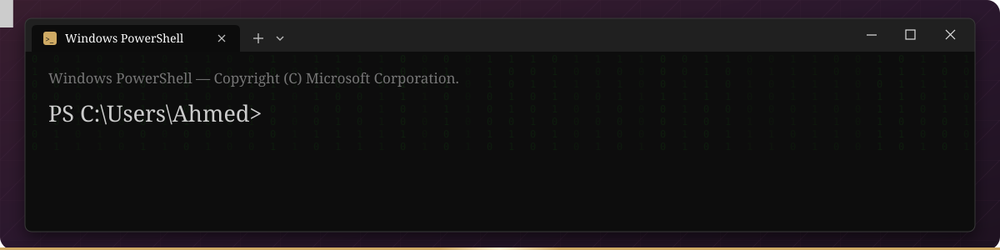

<i>Connecting legal scholarship with computational research and responsible AI.</i>
 
Research focus: Law & AI &nbsp;·&nbsp; Based in Egypt

  

&nbsp;

 

I am an Egyptian legal researcher and international arbitration practitioner with a **PhD in Law**, currently pursuing an **MSc in Information Technology at Alexandria University**.

My interests span **law, artificial intelligence, and data science**, particularly the use of computational methods to study legal texts, reasoning, judicial decisions, and arbitral awards. I am interested in research workflows that are **reproducible, explainable, and grounded in legal methodology**.

My postgraduate studies also involve broader computing disciplines beyond legal applications, including natural language processing, pattern recognition, data mining, and computer networks.

 

<table>
<tr>
<td width="64" align="center"></td>
<td><b>Legal AI & Computational Legal Studies</b> AI-assisted legal research, reasoning, and decision support</td>
</tr>
<tr>
<td width="64" align="center"></td>
<td><b>Natural Language Processing (NLP)</b> Legal text analysis, information extraction, and document classification</td>
</tr>
<tr>
<td width="64" align="center"></td>
<td><b>Machine Learning & Pattern Recognition</b> Classification, clustering, and interpretable pattern analysis</td>
</tr>
<tr>
<td width="64" align="center"></td>
<td><b>International Arbitration</b> Comparative and empirical study of arbitral proceedings and decisions</td>
</tr>
<tr>
<td width="64" align="center"></td>
<td><b>Legal Data Engineering</b> Structured legal datasets, data quality, and reproducible workflows</td>
</tr>
<tr>
<td width="64" align="center"></td>
<td><b>Explainable & Responsible AI</b> Transparency, evaluation, human oversight, and accountability</td>
</tr>
</table>

 

**Currently studying and developing practical foundations in:**
Natural Language Processing · Pattern Recognition · Data Mining & Data Warehousing · Communication Systems & Computer Networks · Applied AI and Data Analysis

| Domain | Technologies and approaches |
| :--- | :--- |
| **Programming & Data** | Python, SQL, data processing, and visualization |
| **AI & Analytics** | NLP, machine learning, pattern recognition, and AI agents |
| **Research Environments** | Jupyter Notebook and Google Colab |
| **Version Control** | Git and GitHub |
| **Research Methodology** | Comparative legal research, empirical analysis, and interdisciplinary methods |

<i>These reflect areas of study and practical work, not claims of expertise in every listed technology.</i>

 

| Principle | Commitment |
| :--- | :--- |
| **Methodological rigor** | Clear questions, explicit assumptions, and defensible evidence. |
| **Reproducibility** | Documented methods, datasets, and limitations where sharing is permitted. |
| **Explainability** | Understandable results and appropriate human review. |
| **Responsible data use** | Attention to confidentiality, privacy, and legal obligations. |
| **Interdisciplinary thinking** | Bringing legal analysis and computational methods into productive dialogue. |

I welcome academic dialogue and interdisciplinary collaboration in **Legal AI**, **Computational Legal Studies**, **NLP**, **empirical legal research**, and **international arbitration**.

